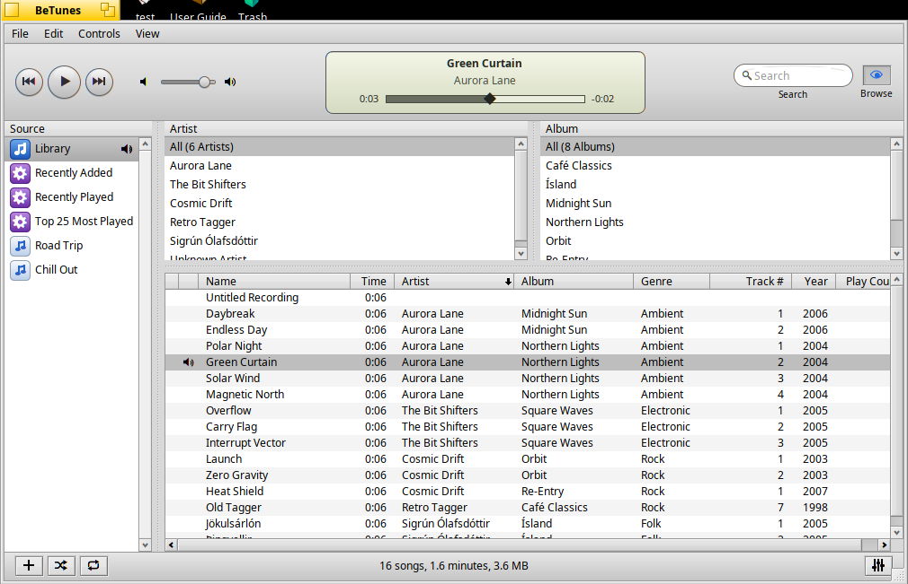
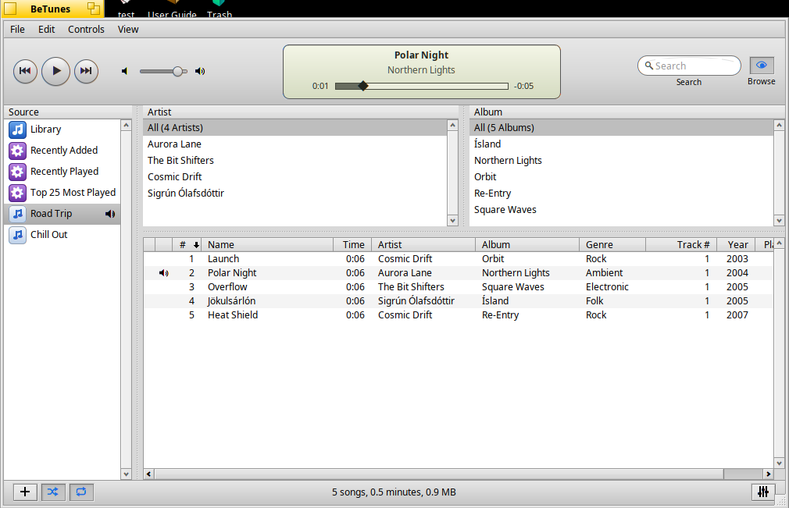
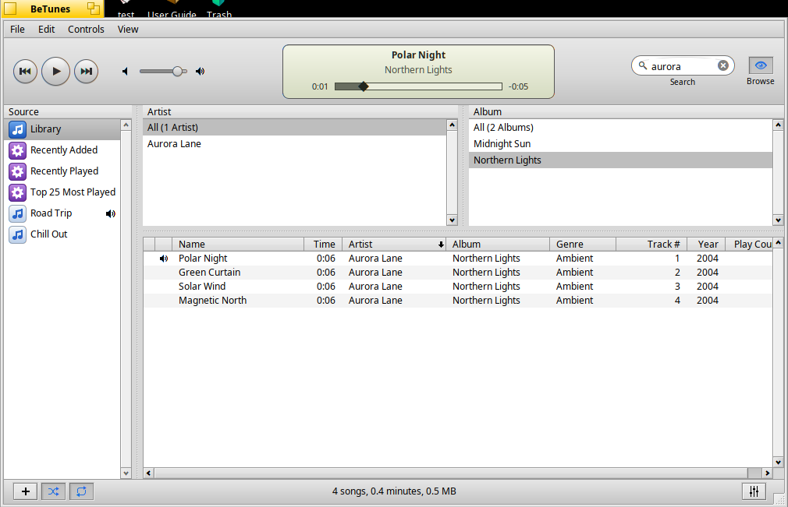
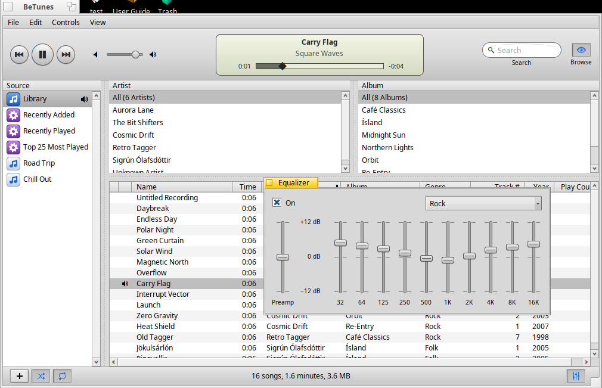
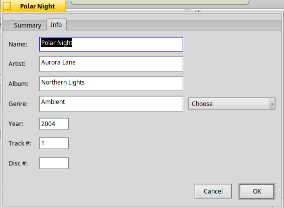
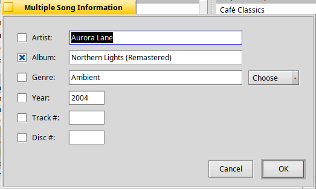
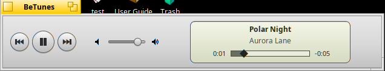
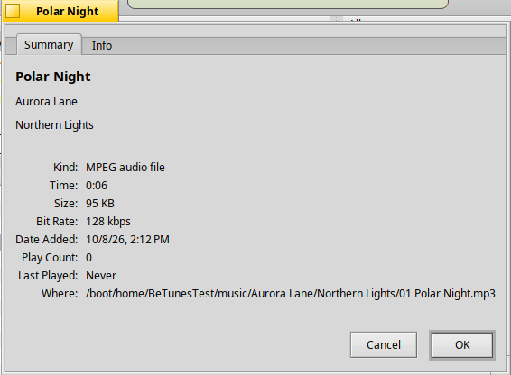
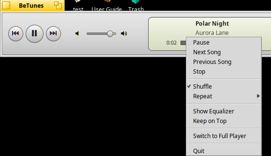

# BeTunes

A music player for Haiku in the spirit of iTunes from the mid 2000s, written
with the native Haiku API: a source list with the library and your
playlists, an artist and album browser, a sortable song list, live search,
shuffle and repeat, a 10 band graphic equalizer, Get Info for editing
song information (one song or many at once, written into MP3 files' tags),
a mini player, and the brushed toolbar with its status "LCD".

## Features

**Library**

- **File > Add to Library…** adds files and whole folders (searched
  recursively); so does dropping files or folders from Tracker anywhere on
  the window. Importing runs in the background, the status display shows
  its progress, and a file that is already in the library is not added
  again.
- Opening audio files or folders with BeTunes from Tracker ("Open with") or
  the command line adds them and plays them.
- Tags come from the Media Kit (ID3v2, Vorbis comments in Ogg/Opus/FLAC,
  MP4 atoms and whatever else the media plug-ins read), with a fallback for
  ID3v1 tags, the BFS audio attributes (`Audio:Artist`, `Media:Title`, …)
  and finally the file name. Tags in ISO-8859-1 are converted to UTF-8.
- Every format the installed media plug-ins decode plays: MP3, Ogg Vorbis,
  Opus, FLAC, AAC/M4A, WAV, AIFF, WMA and more.
- BeTunes never deletes your music files: **Delete from Library** only
  removes songs from the list. The only change it makes to files is
  writing the song information you edit with Get Info into MP3 files'
  tags (see below).

**Source list (left)**

- **Library**: all songs.
- Smart playlists (gear icon): **Recently Added** and **Recently Played**
  (the last two weeks) and **Top 25 Most Played**.
- Your playlists. Make one with the **+** button, **File > New Playlist**,
  **New Playlist from Selection**, or by dragging songs below the last
  playlist. Drag songs onto a playlist to add them; drag files from Tracker
  onto a playlist to import and add them. Double-click a playlist to rename
  it in place; Delete removes it (the songs stay in the library). Right-click
  for the same commands.
- A speaker shows which source is playing.

**Browser (top right)**

- **Artist** and **Album** lists of the current source, each starting with
  "All (n Artists)". Picking an artist narrows the albums and the songs;
  picking an album narrows the songs. Typing jumps to the first match
  ("The" is ignored, like the song list). Double-click plays.
- The **Browse** button (the eye) or **View > Hide Browser** hides it.

**Song list (bottom right)**

- Columns: Name, Time, Artist, Album, Genre, Track #, Year, Play Count; also
  Last Played, Date Added, Kind, Bit Rate and Size. Right-click a column
  title to show or hide columns; drag titles to move them and their edges to
  resize them. The layout is remembered.
- Click a title to sort, again to reverse. Like iTunes, songs that are equal
  in that column stay grouped by artist, album and track (sorting by album
  keeps the tracks in order). Ctrl-click adds a further sort column.
  Artists and albums sort without a leading "The", numbers in names sort
  naturally, accents sort like their letters.
- Playlists show a **#** column; sorted by it, drag songs to reorder the
  playlist. Each kind of source remembers its own sort order.
- Double-click or Enter plays; right-click for Play, Add to Playlist, New
  Playlist from Selection, Show in Tracker and Remove/Delete.
- The bottom bar shows the number of songs, total time and size.

**Get Info**

- **File > Get Info** (Command + I), or right-click songs, shows and edits
  the song information.
- One song: the **Summary** tab shows kind, time, size, bit rate, date
  added, play count, last played and where the file is; the **Info** tab
  has Name, Artist, Album, Genre (the menu next to it offers the genres in
  your library and common ones), Year, Track # and Disc #.

  
- Several songs: the fields they share show their value, the others are
  empty. Each field has a check box; typing in a field ticks it, and only
  ticked fields change, for all the songs (a ticked empty field clears it).
  Name is not offered (several songs rarely share one).
- **OK** changes the library at once and writes the tags of MP3 files in
  the background:
  - The ID3v2 tag is updated in its own version (2.3 or 2.4; a file
    without one gets 2.3; a 2.2 tag becomes 2.3). Every other part of the
    tag is kept as it is: cover pictures, comments, lyrics, ... A track or
    disc total ("3/12") stays. An ID3v1 tag at the end of the file is
    updated too.
  - The audio data is never touched. When the new tag fits into the room of
    the old one it is written in place; otherwise BeTunes writes a copy with
    the new tag and room to spare, gives it the file's attributes (MIME
    type, Tracker's information) and creation time, and only then lets it
    replace the original.
  - A file whose tag BeTunes cannot read safely is left alone, and an alert
    says which one.
- Ogg, FLAC, AAC and other files: the changes are kept in the BeTunes
  library only (the window says so); their files are not changed.

**Mini player**

- The window's zoom button (like iTunes' green button), **View > Switch
  to Mini Player** or Shift + Command + M shrinks BeTunes to its controls:
  previous, play/pause and next, the volume and the status display (with
  the progress bar to seek). The same again brings the full player back,
  at its old size and place.
- All keyboard shortcuts keep working (the menu bar is hidden). Right-click
  the mini player for the main commands: play/pause, next, previous, stop,
  shuffle, repeat, the equalizer, keep on top, the full player, quit.

  
- **Keep on Top** (in that menu or **View > Keep Mini Player on Top**)
  keeps the mini player above all other windows.
- It can be made wider or narrower; its size and place are remembered
  separately from the full player's, and BeTunes starts as it was left.
  **Show Current Song** (Command + L) and **Find** (Command + F) switch to
  the full player.

**Search**

- The field at the top right filters as you type. Every word has to match
  (in any order), case and accents are ignored ("jokul" finds
  "Jökulsárlón"). The magnifier menu limits the search to Artists, Albums,
  Songs or Genres. Escape or the cross clears it. The browser follows the
  search.

**Playing**

- Previous, Play/Pause and Next buttons. Hold Previous or Next to rewind or
  fast forward. Previous goes back to the start of the song first if more
  than three seconds have played.
- The status display shows the song, alternating artist and album (click
  to switch), elapsed and remaining time (click the remaining time for the
  total) and a progress bar: click or drag the diamond to seek. While
  importing it shows the progress.
- Volume slider (the mouse wheel works too; click the small speaker to mute,
  the big one for full volume).
- **Shuffle** and **Repeat** buttons at the bottom left, like iTunes: Repeat
  cycles Off → All → One; they light up blue when on. The same in the
  **Controls** menu.
- BeTunes plays the list you started from, in the order shown (or
  shuffled): changing the view does not change what plays next. A song that
  plays to its end counts as played. Songs that cannot be played (a missing
  file) are skipped and marked with "!".

**Equalizer**

- A graphic equalizer like the one in iTunes: a preamp and ten bands an
  octave apart (32, 64, 125, 250, 500 Hz, 1, 2, 4, 8 and 16 kHz), each from
  −12 to +12 dB. Open it with the button at the bottom right (it lights up
  blue while the equalizer is on) or **View > Show Equalizer**
  (Command + E). It floats above the BeTunes window; closing it only hides
  it.
- **On** switches it on and off; moving a slider or choosing a preset
  switches it on.
- Presets: Acoustic, Bass Booster, Bass Reducer, Classical, Dance, Deep,
  Electronic, Flat, Hip-Hop, Jazz, Latin, Loudness, Lounge, Piano, Pop, R&B,
  Rock, Small Speakers, Spoken Word, Treble Booster, Treble Reducer and
  Vocal Booster. Moving a slider shows "Manual". **Make Preset…** saves the
  current settings under a name (a name in use is replaced); **Delete
  Preset** removes the selected one of your presets.
- Drag a slider or turn the mouse wheel over it (0.5 dB steps); double-click
  puts it back to 0 dB; the tool tip shows the value.
- It works on the sound as it goes out, so every change is heard at once.
  Each band is a peaking filter one octave wide. Boosting a lot can make
  loud songs clip: lower the preamp then, as in iTunes.
- The settings, your presets and the window's place are remembered.

**Keyboard**

| Key | |
|---|---|
| Space | play / pause (when not typing) |
| Enter, double-click | play the selected song |
| Command + → / ← | next / previous song |
| Command + . | stop |
| Command + ↑ / ↓, Command + M | volume up / down, mute |
| Command + L | show the current song |
| Command + F, Escape | search, clear the search |
| Command + B | hide / show the browser |
| Command + E | show / hide the equalizer |
| Shift + Command + M, the zoom button | mini player / full player |
| Command + N, Shift + Command + N | new playlist, from the selection |
| Command + O | add to library |
| Command + R | show in Tracker |
| Command + I | Get Info |
| Command + A, Shift + Command + A | select all / none |
| Delete | remove from the playlist, delete from the library (asks), delete a playlist (in the source list) |

## Files

    ~/config/settings/BeTunes/Library     songs, play counts, playlists
    ~/config/settings/BeTunes/Settings    window, columns, volume, shuffle, repeat,
                                          equalizer and your presets

Both are flattened BMessages, written to a new file and renamed, so a crash
cannot leave a half-written library.

## Without sound hardware

BeTunes plays through the system mixer with a `BSoundPlayer`. If the audio
output cannot be opened, BeTunes stops and says so. To use it anyway (or
to run the tests on a virtual machine without sound), start it with a
silent output that only keeps time:

    BETUNES_AUDIO=silent BeTunes

## Building

On Haiku, with the `haiku_devel` package installed:

    make

The application is `objects.x86_64-cc13-release/BeTunes`. To build the
package:

    bash package/build-package.sh
    pkgman install package/betunes-1.0.1-3-x86_64.hpkg

The package puts BeTunes in the Deskbar's Applications menu; BeTunes also
appears in Tracker's "Open with" menu for audio files and folders.

The icon is generated: `python3 tools/make_icon.py` writes
`artwork/BeTunes.hvif`; `tests/render_icon.cpp` renders it at several sizes
into a PNG for checking.

## Testing

Unit tests for the parts that do not need Haiku (search folding, ID3v1,
tag text, the play queue, the equalizer's filters and presets, the ID3 tag
writer with every tag version, unsynchronisation, damaged tags, the copy
and in-place paths), on any system:

    bash tests/run-unit-tests.sh

The ID3 tag writer against ffmpeg (needs ffmpeg and ffprobe): it edits real
MP3 files (ID3v2.3 with a cover picture, ID3v2.4, no tag, ID3v1 only) and
checks that ffprobe reads the new tags, that the picture is still there
and that the decoded audio is bit for bit the same:

    bash tests/tag-test.sh

The end-to-end test drives BeTunes with `hey` on Haiku (227 checks: import
and tags of every format, the browser, search scopes, sorting, play, pause,
seek, previous/next, the end of a song, repeat one/all/off, shuffle,
volume, the equalizer and its window, playlists and their order, Get Info
for one and for several songs with the tags read back through the Media
Kit (`tests/readtags.cpp`) and the file attributes kept, a file that cannot
be written, Ogg and FLAC files, the mini player (what is hidden, its
size, keyboard shortcuts typed with `tests/sendkey.cpp`, the zoom
button, keep on top), removing songs, smart playlists, a missing file,
settings and library after a restart). It works on a copy of the test
music. It uses the silent output and its own settings. With
`BETUNES_AUDIO_DUMP=<file>` the silent output also writes what it plays to
a file (raw float samples); the test measures the level of a song with
`tests/levels.cpp` to check that the equalizer really changes the sound
(boosting 500 Hz by 12 dB, cutting it, the preamp, off):

    bash tests/make-test-music.sh /boot/home/BeTunesTest/music   # needs ffmpeg
    bash tests/gui-test.sh objects.x86_64-cc13-release/BeTunes /boot/home/BeTunesTest/music

`tests/make-test-music.sh` writes short tagged songs as MP3 (ID3v2.3,
ID3v2.4, ID3v1 only), Ogg Vorbis, Opus, FLAC, AAC and WAV.
`tests/output-error-test.sh` checks that BeTunes stays responsive and
explains itself when the audio output cannot be opened.
`tests/readme-shots.sh` takes the screenshots above.

## Scripting

Every command can be sent with `hey`; BeTunes replies when it is done.
Examples:

    hey BeTunes Bply of Window 0                       # play / pause
    hey BeTunes Bpsa of Window 0 with row=int32(3)     # play the 4th row
    hey BeTunes Bsch of Window 0 with text='"aurora"'  # search
    hey BeTunes Bimp of Window 0 with path='"/boot/home/Music"'
    hey BeTunes Bsta of Window 0                       # state: song, time, ...

| Code | Command | Fields |
|---|---|---|
| `Bply` `Bstp` `Bnxt` `Bprv` | play/pause, stop, next, previous | |
| `Bpsa` | play a row of the song list | `row` (−1: first, or random when shuffling) |
| `Bsek` | seek | `position` float 0…1 or `time` int64 (µs) |
| `Bscn` | rewind / fast forward 2 s | `direction` (−1, 1) |
| `Bvol` `Bvup` `Bvdn` `Bmut` | volume, up, down, mute | `volume` 0…100 |
| `Bshf` `Brpt` | shuffle, repeat | `shuffle` bool, `mode` 0 off, 1 all, 2 one |
| `Bsch` `Bscp` | search text, scope | `text`, `scope` 0 all, 1 artists, 2 albums, 3 songs, 4 genres |
| `Bsrs` `Bsse` `Bsby` | select a source, select rows, sort | `select`, `column` and `ascending` |
| `Bimp` | add to the library | `path` strings, `playlist` id |
| `Bnpl` `Bnps` `Brnp` `Bdpl` | new playlist (from selection), rename, delete | `name`, `playlist`, `confirmed` |
| `Batp` `Bmov` `Bdel` | add songs to a playlist, move, remove/delete | `playlist`, `song` ids; `from`, `to`; `confirmed` |
| `Bbrw` `Bcur` | hide/show the browser, show the current song | |
| `Bmin` `Bmtp` | mini player, keep it on top | `mini` bool, `on top` bool (none: switch) |
| `Binf` | Get Info for the selected songs (then `Iok ` or `quit` to its window) | |
| `Bapi` | change song information (library and tags) | `song` ids; `title`, `artist`, `album`, `genre`, `year`, `track`, `disc` strings |
| `Beqw` | show/hide the equalizer | `show` bool (none: toggle) |
| `Beqc` | change the equalizer | `preset` name, `enabled` bool, `preamp` float, `gains` floats, or `band` int32 + `gain` float |
| `Beqm` `Beqd` | make / delete a preset | `name` |
| `Bsta` `Bgsl` `Bgbr` `Bgsr` | state, visible songs, browser lists, sources | (replies) |

Column numbers for `Bsby`: 1 #, 2 Name, 3 Time, 4 Artist, 5 Album, 6 Genre,
7 Track #, 8 Year, 9 Play Count, 10 Last Played, 11 Date Added, 12 Kind,
13 Bit Rate, 14 Size.

## Source overview

| File | What it does |
|---|---|
| `src/App.cpp` | Application: Tracker and command line launches, About |
| `src/MainWindow.cpp` | The window: layout, menus, filtering, playback control, playlists, scripting |
| `src/Player.cpp` | Decoder thread (BMediaFile/BMediaTrack) feeding a ring buffer; seek, pause, volume, equalizer |
| `src/Equalizer.cpp` | The equalizer's filters (Audio EQ Cookbook peaking filters) and presets |
| `src/EqualizerWindow.cpp` | The Equalizer window, its sliders and the preset name dialog |
| `src/AudioOutput.cpp` | BSoundPlayer output (with format conversion) and the silent output |
| `src/PlayQueue.cpp` | Play order: list order or shuffled, repeat, removal |
| `src/Library.cpp` | Songs, playlists, smart playlists, loading and saving |
| `src/Importer.cpp` | Background import: folder walk, batches to the window |
| `src/TagReader.cpp` | Tags, duration, kind and bit rate of a file |
| `src/Id3Tag.cpp` | Writing ID3v2/ID3v1 tags into MP3 files (no Haiku API) |
| `src/TagWriter.cpp` | Writes tags in the background, keeps file attributes |
| `src/InfoWindow.cpp` | The Get Info window (Summary and Info, several songs) |
| `src/TextUtils.cpp` | Search folding, ID3v1, numbers, UTF-8, time formatting |
| `src/SourceList.cpp` | The source list: icons, drops, renaming in place |
| `src/BrowserList.cpp` | Artist and album lists with type-ahead |
| `src/SongList.cpp` | The song list (BColumnListView): columns, sorting, dragging |
| `src/StatusDisplay.cpp` | The status "LCD" with the seekable progress bar |
| `src/SearchField.cpp` | The rounded search field with its scope menu |
| `src/Controls.cpp` | Toolbar look, transport buttons, volume slider, icon buttons, headers |
| `src/Icons.cpp` | Vector glyphs and source icons |
| `src/Settings.cpp` | Settings files |

## License

MIT, see `LICENSE`.
